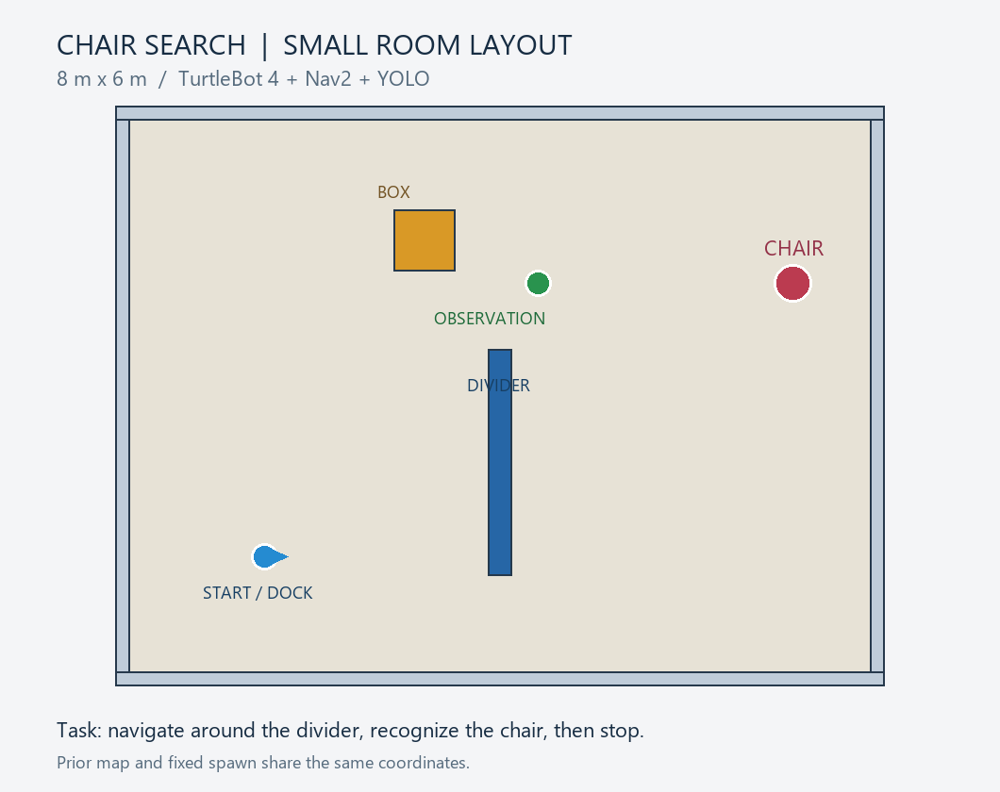

# AI物体認識を用いた移動ロボットの椅子探索

## 概要・目的

ROS 2とGazeboを使用し、移動ロボットが障害物を避けて確認地点へ移動し、
カメラ画像から椅子を認識して停止するシミュレーションを作成した。
移動にはNav2、物体認識には学習済みYOLO11sモデルの推論を利用した。
目的は、自律移動とAIによる画像認識をROS 2で連携させ、認識結果に応じて
ロボットの行動を変える仕組みを実装することである。

## タスクの流れ

1. 充電台から離脱する。
2. 事前設定した確認地点へ、Nav2で経路を計画して移動する。
3. 移動中と到着後のカメラ画像に対し、YOLO11sで物体検出を行う。
4. 必要に応じてその場で旋回し、椅子を探す。
5. 椅子を複数画像で確認すると、移動・旋回を終了して `FOUND - TASK COMPLETE` を表示する。

## 工夫した点

- **認識の安定化**：椅子全体が写るよう確認地点を約2.7m離し、車輪付きの回転椅子から
  背もたれ・座面・4本脚の単純な椅子モデルへ変更した。
- **誤検出への対策**：移動中は3画像連続での検出を要求する。旋回中に候補を見つけると
  一度止まり、停止後の最大5画像のうち3画像で確認してから発見とする。
- **計算負荷の軽減**：約8m×6mの小部屋を使い、影を無効化し、画像推論を原則2Hzで実行する。
- **再実行のしやすさ**：部屋の固定物から事前地図を生成し、開始位置・椅子・確認地点を固定した。
- **状態の可視化**：AI映像に検出枠とタスク状態を表示し、診断用画像を自動保存する。

## 使用環境

| 項目 | 内容 |
|---|---|
| ホスト | Windows 11、メモリ16GB、NVIDIA GeForce RTX 3060 Ti |
| Linux環境 | WSL 2 / Ubuntu 24.04 |
| ロボット制御 | ROS 2 Jazzy / Nav2 |
| シミュレーター | Gazebo Harmonic、センサー描画はOgre 2 |
| ロボット | TurtleBot 4 Standardのシミュレーションモデル |
| 物体認識 | Ultralytics YOLO11s、640ピクセル入力、CPU推論 |

## 実行方法

環境構築は **[セットアップ手順](docs/SETUP.md)** を参照。
セットアップ後、このリポジトリのフォルダーで次を実行する。

```bash
bash demo.sh prepare
```

以下は上から順番に実行する。sim・nav・ai・cameraは、それぞれ別端末で動かす。
各端末ではこのリポジトリのフォルダーへ移動してから実行する。

| 順序 | コマンド | 内容 |
|---|---|---|
| 1 | `bash demo.sh sim` | 部屋・ロボット・椅子を起動 |
| 2 | `bash demo.sh nav` | 事前地図・位置推定・Nav2を起動 |
| 3 | `bash demo.sh undock` | 充電台から離脱。SUCCEEDEDを待つ |
| 4 | `bash demo.sh ai` | YOLO11sによる画像推論 |
| 5 | `bash demo.sh camera` | `/ai/detections/image` の映像を表示 |
| 6 | `bash demo.sh search` | 移動と椅子探索を開始 |

起動時の位置を自動設定するため、開始直後の2D Pose Estimateは不要。
最初のnav起動前にロボットを手動で動かさないこと。
終了は各端末でCtrl+C。再試行ではsimとnavも終了し、上記の順で起動し直す。



## 実行結果と範囲

実行環境で、確認地点への移動、椅子の繰り返し検出、タスク完了表示を確認した。
探索範囲は事前設定した1つの確認地点とその周囲である。
地図はシミュレーションの固定物から作る事前地図であり、SLAMによる作成は行っていない。
AIは学習済みモデルの推論を利用し、この課題で追加学習は行っていない。
モデルの出力は視点により変動し、完了後のフレームで別のクラスが表示されることもある。
完了判定は、それまでの複数画像での椅子検出に基づく。

実演動画は課題の提出先へ提出する。GitHubにも動画の案内を載せる場合は、ここへ動画のURLを追記する。

## コード構成

| ファイル | 役割 |
|---|---|
| `demo.sh` | 起動コマンドとWSL向けGPU設定 |
| `room_geometry.py` | 小部屋・4本脚の椅子・事前地図の生成 |
| `prepare_demo.py` | インストール済み設定を使った実行用ファイルの準備 |
| `room_demo.launch.py` | Gazeboとロボットの起動 |
| `room_navigation.launch.py` | 位置推定とNav2の起動 |
| `camera_detector.py` | YOLO推論・検出枠・状態表示・画像保存 |
| `search_chair.py` | 移動・旋回・検出確認・キャンセルの処理 |
| `room_search.py` | 充電台状態の確認・タスク状態の配信・結果保存 |
| `check_scan.py` | レーザー測定値と座標変換の診断 |
| `room_gui.config` / `room.rviz` | GazeboとRVizの表示設定 |

生成ファイルは `runtime/` に保存する。モデル重み、仮想環境、ログ、録画はGitの管理対象から除外する。

## 確認用コマンド

```bash
bash demo.sh check
bash demo.sh status
python3 -m unittest discover -s tests -p 'test_*.py'
python3 tests/check_search_behavior.py
```

ローカルテストでは、部屋と地図の一致、移動経路の存在、椅子の構造、設定ファイル、
検出確認・キャンセル・起動時刻の処理を確認する。
テストにはROS機能の模擬実装も含むため、実際のGazeboでの動作確認も必要。

## 使用した外部ソフトウェア

- [ROS 2 Jazzy](https://docs.ros.org/en/jazzy/)
- [Gazebo Harmonic](https://gazebosim.org/docs/harmonic/)
- [TurtleBot 4 Simulator](https://github.com/turtlebot/turtlebot4_simulator)
- [TurtleBot 4 Navigation](https://github.com/turtlebot/turtlebot4)
- [Nav2](https://docs.nav2.org/)
- [Ultralytics YOLO11](https://docs.ultralytics.com/models/yolo11/)

各ライブラリ・モデルの権利とライセンスは、それぞれの配布元に従う。
